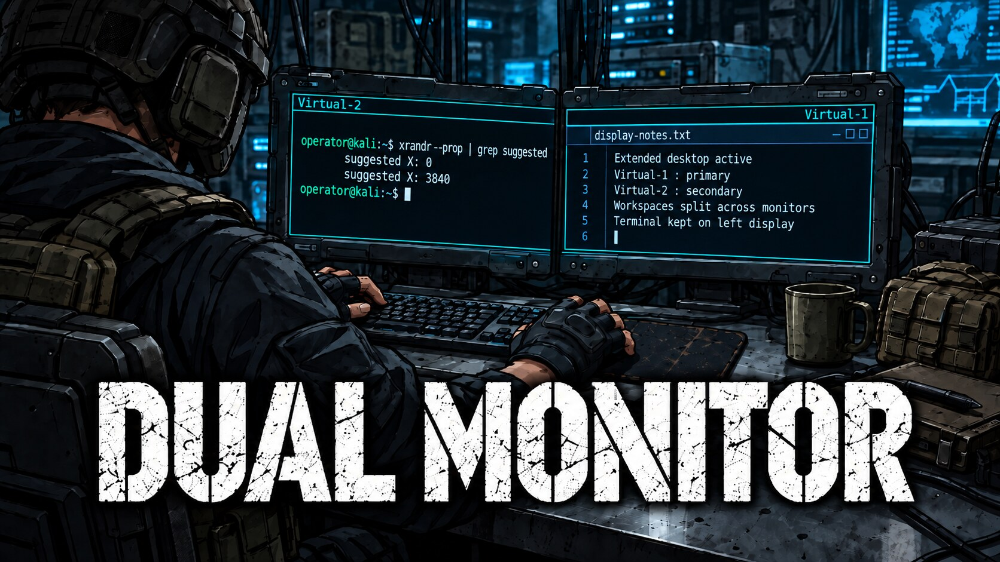

<p align="center"></p>

# kali-vmware-dual-monitors

Fixes two-monitor Kali guests on VMware Workstation when **Cycle Multiple Monitors** mirrors the screens or clicks land a monitor-width away from the pointer.

Write-up: [Fixing Kali Dual Monitors on VMware Workstation](https://bltsec.com/blog/kali-vmware-dual-monitors/)

On Parallels Desktop for macOS instead? Black full-screen monitors there are a different problem: see [kali-parallels-dual-monitors](https://github.com/BLTSEC/kali-parallels-dual-monitors).

## Why

- VMware reports where each virtual screen sits through the `vmwgfx` `suggested X/Y` properties, and maps the mouse with that layout. The guest has to use the same positions. Name order (`Virtual-1` left) is often wrong.
- Even with correct positions, the second screen mirrors the first until it is turned off and back on after VMware connects it.
- On XFCE, Kali's `xautoresize` collapses the extended layout back to one screen.

The watchers read VMware's hints, wait for the hotplug to settle, reset the new output, and apply the layout.

## Install

Start from a working single-monitor session. Set **VM Settings → Display → 2 monitors** with the VM powered off.

```sh
git clone https://github.com/BLTSEC/kali-vmware-dual-monitors.git
cd kali-vmware-dual-monitors
./install.sh xfce          # XFCE / X11, also hides xautoresize for your user
./install.sh kde-wayland   # KDE Plasma / Wayland (needs: sudo apt install drm-info)
```

Both install to `~/.local/bin` with an XDG autostart entry. They need no root and no system file changes.

**KDE X11 and the SDDM login screen** (optional, needs root):

```sh
sudo install -m 755 kde-x11/vmware-monitor-layout kde-x11/sddm-xsetup-vmware /usr/local/bin/
sudo install -Dm 644 kde-x11/10-vmware-monitors.conf /etc/sddm.conf.d/10-vmware-monitors.conf
```

On KDE X11, run `vmware-monitor-layout` once after cycling and KScreen saves the result. Don't use it on XFCE alongside the XFCE watcher.

## Use

Press **Ctrl+Alt+Enter** (full screen) first, then click **Cycle Multiple Monitors**. The second screen flickers once within a few seconds.

Check by dragging a window across both screens and clicking on each.

```sh
xrandr --prop | grep -E '^Virtual|suggested [XY]'   # what VMware expects
pgrep -af vmware-monitor                            # watcher running
tail ~/.local/state/vmware-monitors/watcher.log     # XFCE log
```

If clicks go wrong, press **Ctrl+Alt** to release input, then **Ctrl+Alt+Enter** to leave full screen.

## Uninstall

```sh
./install.sh uninstall
```

## Tested

Windows 11 host, VMware Workstation Pro, 2× 3840×2160. Kali kernel 7.1.5, open-vm-tools 13.0.10, XFCE 4.20 (X11), Plasma 6.7 (Wayland and X11). Supports one or two outputs (`Virtual-1`, `Virtual-2`).

## License

MIT
